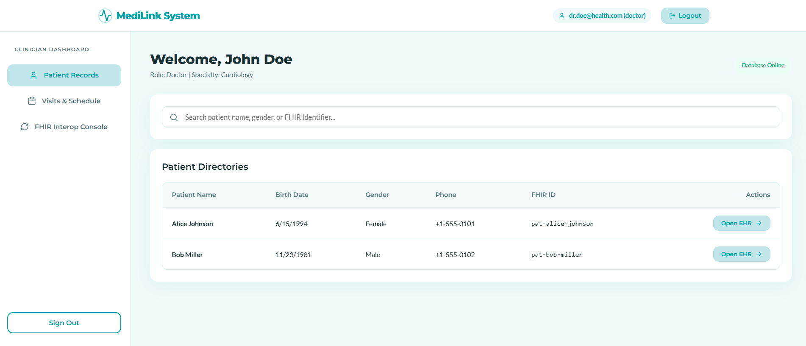
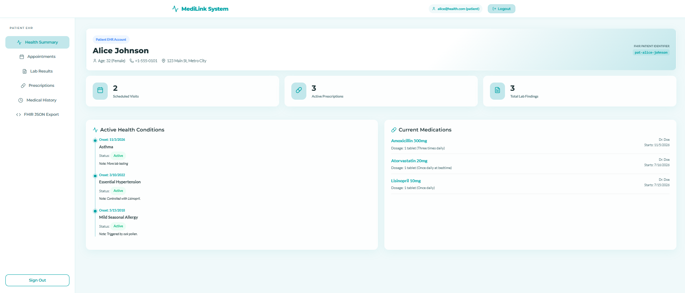
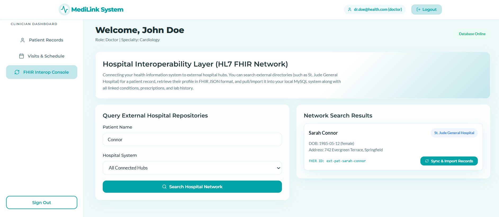
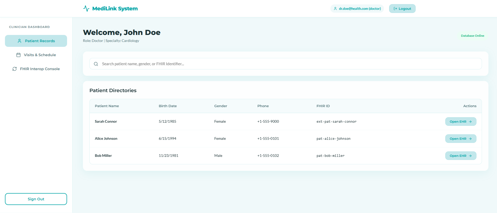
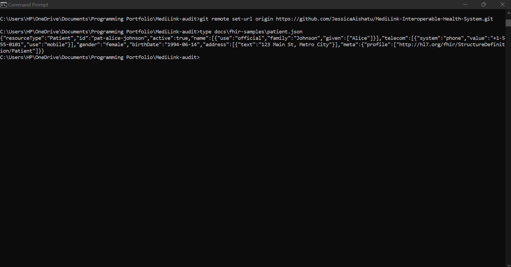

# MediLink — Interoperable Health Information System

A full-stack electronic health record system with role-based access for doctors and patients, an **HL7 FHIR R4 API**, and a cross-hospital record import that pulls a patient's FHIR resources from an external source into the local database. Built as a personal project to learn how health systems exchange data.



## What it does

- **Authentication and role-based access**: JWT login; patient, doctor and admin roles enforced server-side (a patient token is refused on clinician routes with 403).
- **Clinician dashboard**: patient directory with search, visits and schedule, and a per-patient EHR view where doctors record conditions, lab results and prescriptions.
- **Patient dashboard**: a patient sees their own appointments, conditions, medications and lab results, books appointments, and can view their record as FHIR JSON.
- **FHIR R4 API**: Patient, Observation (lab results), Condition (medical history) and MedicationRequest (prescriptions) served as FHIR resources, with `?patient=` search on the three clinical resources.
- **Cross-hospital import**: the FHIR Interop Console searches an external hospital source by surname, shows the FHIR Patient returned, and imports the patient with linked conditions, prescriptions and labs into MediLink.

| | |
| --- | --- |
|  |  |
| Patient view | Searching the external source |
|  |  |
| Imported record in the directory | Raw FHIR Patient resource |

## Architecture

React single-page app (Vite) → Express REST API with JWT and RBAC → MySQL 8. The FHIR module (`backend/routes/fhir.js`) maps MySQL rows to R4 resources on request. The interop module (`backend/routes/interop.js`) searches an external patient source and maps incoming FHIR resources into MediLink's tables. In the current version the external source is a mock inside the backend; replacing it with a separate FHIR server is the next step (see Roadmap).

## FHIR support

Base path: `/api/fhir`. All FHIR routes except `/metadata` require a JWT (`Authorization: Bearer <token>`); obtain one from `POST /api/auth/login`. Every resource has been checked against the HL7 FHIR R4 validator with zero errors; reports and samples are in `docs/fhir-samples/`, and the full conformance statement in `docs/fhir-conformance.md`.

| Resource | Interactions | Search parameters | Source table → FHIR mapping |
| --- | --- | --- | --- |
| Patient | read | — | patients: fhir_id → id and identifier (system `http://medilink.example/mrn`); first_name/last_name → name; gender; birth_date → birthDate; phone → telecom; address → address.text |
| Practitioner | read | — | doctors: id → `doc-{id}`; first_name/last_name → name with prefix Dr.; phone → telecom; specialty → qualification.code.text |
| Observation | search-type | patient | lab_results: test_name → code (LOINC via lookup table, else text); result_value/result_unit → valueQuantity (UCUM) or valueString; test_date → effectiveDateTime; status completed → final, otherwise registered; reference_range → referenceRange.text; performer fixed to Organization/medilink |
| Condition | search-type | patient | medical_histories: condition_name → code (SNOMED via lookup table, else text); status → clinicalStatus active/resolved; onset_date → onsetDateTime; notes → note |
| MedicationRequest | search-type | patient | prescriptions: medication_name → medicationCodeableConcept (RxNorm via lookup table, else text); start_date → authoredOn; end_date in the past → status completed, else active; doctor → requester Practitioner/doc-{id}; dosage/frequency → dosageInstruction.text and timing |
| CapabilityStatement | read (`/metadata`, no auth) | — | generated |

Search Bundles are `searchset` type with a `self` link and `search.mode = match` on each entry. Not supported: per-resource reads for Observation/Condition/MedicationRequest, FHIR create/update, Bundle transactions, SMART on FHIR / OAuth2 (full list in the conformance document).

## Run it

Prerequisites: Node.js 18+ and MySQL 8.0.

```bash
git clone https://github.com/JessicaAishatu/MediLink-Interoperable-Health-System.git
cd MediLink-Interoperable-Health-System/backend
copy .env.example .env        # then set DB_PASSWORD to your MySQL root password
npm install
npm run db:setup              # creates the health_system database, tables and demo data
npm start                     # API on http://localhost:5000
```

In a second terminal:

```bash
cd ../frontend
npm install
npm run dev                   # app on http://localhost:5173
```

Demo accounts (password `password123`): `dr.doe@health.com` (doctor), `alice@health.com` (patient), `bob@health.com` (patient), `admin@health.com` (admin). `npm run db:setup` skips seeding if the database already exists; drop it to reseed.

To call the FHIR API directly:

```bash
curl -X POST http://localhost:5000/api/auth/login -H "Content-Type: application/json" -d "{\"email\":\"dr.doe@health.com\",\"password\":\"password123\"}"
curl -H "Authorization: Bearer <token>" http://localhost:5000/api/fhir/Patient/pat-alice-johnson
```

## Data

All patients, clinicians and records are fictional demo data created by `backend/scripts/setup-db.js`. No real person or institution is represented.

## Known issues

Found in a clean-clone audit (`docs/audit.md`) and being fixed:


- A stale token in browser storage causes a 403 that crashes the doctor dashboard instead of redirecting to login.
- CORS allows any origin; `.env.example` ships a non-placeholder JWT secret.

## Roadmap

1. Replace the in-process mock with a separate FHIR server so the import is a real two-system exchange.
2. Tests (Jest/supertest), security hardening, and a documented data mapping.

## Provenance

MediLink is a personal project. The authentication, role-based access control and dashboard patterns come from what I learned in CSC702 (Computer, Web and Mobile Programming, Nile University of Nigeria), applied to a design of my own with AI assistance for boilerplate and debugging. The HL7 FHIR R4 layer and the cross-hospital import are my own additions; the resource mappers were drafted with AI assistance and are being validated and corrected against the R4 specification.

## Licence

MIT (see `LICENSE`).
